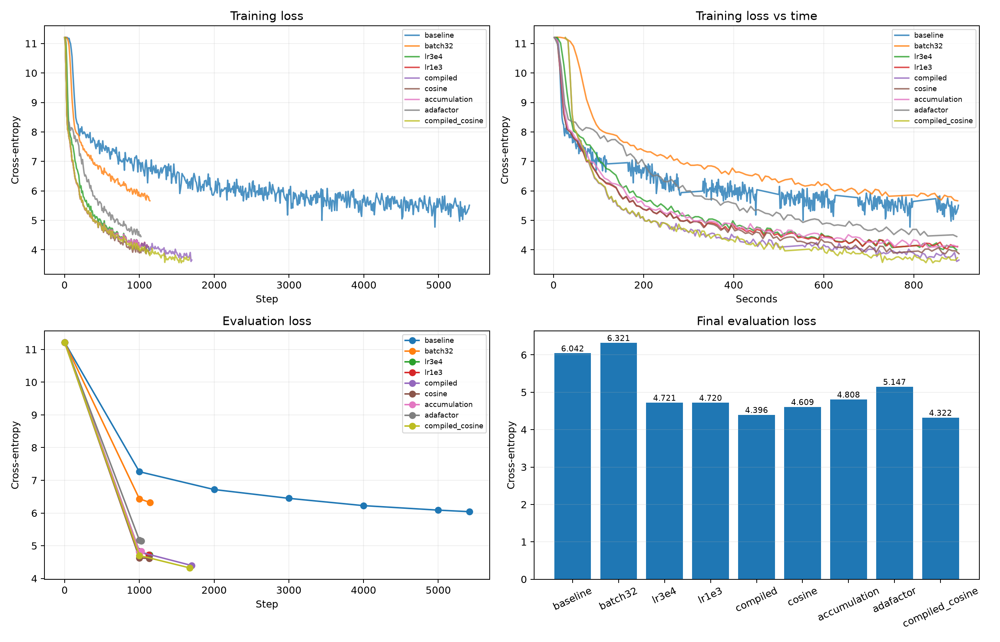
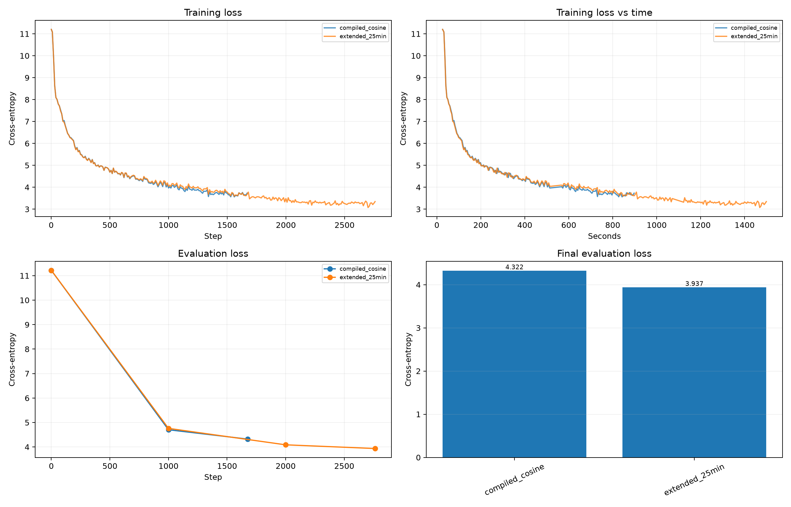

# HW1: мини-претрейн Qwen3

## Эксперименты

По умолчанию был AdamW fused, `constant_with_warmup`, без компиляции, bf16. 
В первом экспе поменял размер батча, ошибся и везде дальше запускался с тем, что хуже. Потом попробовал два других lr. Выбрал лучший. Потом попробовал torch_compile, стало лучше по лоссу из-за ускорения. Потом попробовал другое расписание lr, но без компиляции, было лучше чем `constant_with_warmup`.
Потом пробовал батч не целиком прогонять, а по очереди, лосс хуже, модель меньше данных прогнала, но затраты памяти упали с 39 до 16 ГБ. Adafactor прироста не дал, а времени подобрать ему lr не было. 
В конце сделал запуск с torch_compile + cosine - лучший запуск.

| Batch × accumulation | LR | Настройки | Eval loss |
| --- | --- | --- | ---: |
| 4 × 1 | 5e-5 | Базовые | 6,04185 |
| 32 × 1 | 5e-5 | Базовые | 6,32092 |
| 32 × 1 | 3e-4 | Базовые | 4,72147 |
| 32 × 1 | 1e-3 | Базовые | 4,71976 |
| 32 × 1 | 1e-3 | torch_compile | 4,39639 |
| 32 × 1 | 1e-3 | Cosine, 1200 шагов | 4,60887 |
| 8 × 4 | 1e-3 | Накопление градиентов | 4,80761 |
| 32 × 1 | 1e-3 | Adafactor | 5,14739 |
| 32 × 1 | 1e-3 | torch_compile + cosine, 1800 шагов | **4,32196** |

Лучший 15-минутный результат: perplexity **75,34**. Повышение LR и компиляция дали основной выигрыш; компиляция увеличила скорость примерно на 51%.

Дополнительно(время осталость) выполнен запуск с нуля на 25 минут с лучшими настройками и горизонтом cosine 3000 шагов: 2763 шага, eval loss **3,93699**, perplexity **51,26** (на 32% ниже)

Один seed; для подбора использовался тот же eval-набор.

## Генерации

Промпт: Рассуждая о наиболее перспективных проектах исследования космоса я бы выделил

Greedy зацикливается на «Культурное наследие» после 15 минут и «в России» после 25. Sampling даёт более длинные фразы, но уходит от темы и остаётся несвязным. Снижение loss пока не обеспечило осмысленного ответа.

Код: [шаблон](your_solution.py), [эксперименты и генерация](experiment.py), [25 минут](extended_experiment.py). Полные настройки — в [configs](configs/). Таблицы: [основная серия](results.csv), [25 минут](extended_results.csv).
